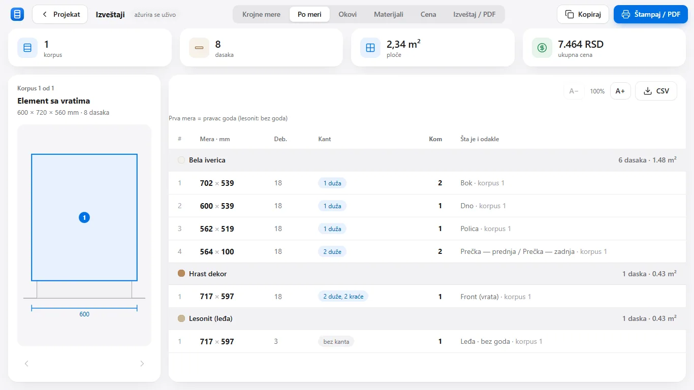

# Uputstvo za pisce tekstova (rečnik, vodiči, namena, pitanja)

Čitaj prvo: `docs/CINJENICE-STRUKA.md` (brojevi i pravila struke — jedini izvor brojeva), `blog/sr/krojna-lista.md` (uzor stila), `tekst/sr.json` (rečnik sajta).

## Oblik fajla (Markdown sa zaglavljem)
```
---
naslov: Naslov (to je jedini H1; ne pisati # u tekstu)
opis: Jedna rečenica za Google, do 160 znakova, sa pojmom koji majstor kuca
datum: 2026-11-04
slika: ../slike/web/snimak-12-korpus-sa-vratima-1600.webp
---
Uvodni pasus bez naslova (2–3 rečenice: šta je i zašto je bitno).

## Podnaslov celine (H2; po jedan na celinu)
Pasusi. **Podebljano** za ključnu reč. Liste sa „- “. Tabele sa | kolonama |.



Poslednja rečenica: jedna, mirna, poziva na probu (dugme „Preuzmi probnu verziju“ dodaje šablon sam — NE pisati ga).
```
- Putanje slika uvek `../slike/web/<ime>-1600.webp` (ili -800). Dostupne slike: snimak-12-korpus-sa-vratima, snimak-13-korpus-sa-fiokama, snimak-14-sudopera, snimak-19-krupni-prikaz, snimak-33-po-meri, snimak-37-cena, snimak-39-cokla, snimak-41-kuhinja-sonoma-bela-laminat, snimak-44-soba-pod-zid, snimak-45-kuhinja-plocice-mermer, snimak-46-izbliza-front, snimak-47-svoj-dezen, snimak-52-ruka-jedna-vrata, isecak-kote (520×330), isecak-cena (676×180), isecak-front (500×380), isecak-dezeni (290×300), isecak-po-meri-tabela (1018×440). Svaki tekst ima bar jednu sliku sa pravim alt tekstom (šta se vidi, ne „slika“).
- Linkovi relativno: drugi pojam u rečniku `./kant.html`, vodič `../blog/sistem-32.html`, rečnik iz vodiča `../recnik/kant.html`, odeljak sajta `../#kako-radi` / `../#mogucnosti` / `../#cena`, preuzimanje `../preuzimanje.html`. Bar 2 unutrašnja linka po tekstu, prirodno u rečenici.
- Imena fajlova (slug) su zadata i ista u svim jezicima — ne menjati.

## Pravila sadržaja
- Istina pre svega: brojevi samo iz `docs/CINJENICE-STRUKA.md` ili označeni kao „uobičajeno / po katalogu proizvođača“. Ništa izmišljeno: bez brojeva korisnika, bez recenzija, bez poređenja sa imenovanim programima, bez obećanja koja program nema (program je na srpskom i engleskom, Windows, bez CNC izvoza i nestinga u ovoj verziji).
- Jedan pojam = jedna definicija u prvoj rečenici. Zatim standardne mere, pa kako se radi u radionici, pa „Kako to radi TOPICA“ (jedna do dve rečenice, sa linkom na odeljak sajta).
- Dužine: rečnik 150–300 reči; vodiči 600–1000; namena 400–600; pitanja: 20 pitanja, odgovor 40–90 reči.
- Stil: srpski latinica, „ti“ (kolega kolegi), kratke rečenice, konkretan primer sa brojevima gde može, bez praznog hoda i bez marketinških fraza. Majstor treba da pročita do kraja jer uči nešto.
- Pitanja (`pitanja/sr/index.md`): zaglavlje ima i `tip: pitanja`; svako pitanje je `## Pitanje?` pa pasus odgovora (iz toga se pravi FAQ JSON-LD). Pitanja onako kako ih majstori stvarno kucaju u Google i pišu po grupama.
